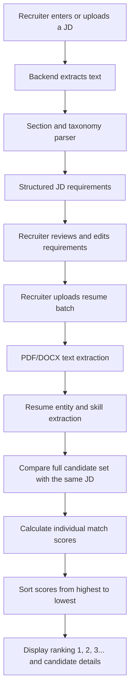

# Resume Matcher

A recruiter-focused application that compares multiple candidate resumes with a job description and produces an explainable match ranking.

## Project Aim

Recruiters often need to review many resumes manually against the same set of role requirements. Resume Matcher aims to reduce that workload by:

- Parsing a job description into structured requirements
- Separating required and preferred skills
- Extracting candidate information from PDF and DOCX resumes
- Comparing each candidate with the job description
- Ranking all candidates on one shared dashboard
- Providing reasons behind every match score

The project is currently a local full-stack prototype. The React interface and FastAPI services handle the recruiter workflow, while PostgreSQL Docker configuration provides the intended data-persistence layer.

## Implemented Modules

1. **Job Description Analysis** – Paste or upload a JD and extract required skills, preferred skills, experience, education, responsibilities, certifications, soft skills, and eligibility.
2. **Resume Upload** – Upload multiple PDF or DOCX resumes in one batch.
3. **Candidate Extraction** – Extract name, email, phone, skills, education, summary, and experience from uploaded resume text.
4. **AI-Assisted Matching** – Calculate skill coverage, semantic similarity, experience, and education scores.
5. **Candidate Ranking** – Sort candidates by overall match percentage, with rank 1 representing the strongest match in the uploaded batch.
6. **Candidate Analysis** – Select a ranked candidate to inspect matched skills, missing skills, experience, education, and score explanations.

## Technology Stack

| Area | Technology | Purpose |
|---|---|---|
| Frontend | React 18, Vite | Recruiter dashboard and interactive workflow |
| Backend | Python, FastAPI | REST API, document handling, and matching services |
| Data validation | Pydantic | Typed JD and candidate data models |
| Resume parsing | pypdf, python-docx | PDF and DOCX text extraction |
| NLP and skills | Regular expressions, section rules, skill taxonomy | Structured extraction and text normalization |
| Semantic AI | SentenceTransformers (`all-MiniLM-L6-v2`) | Convert text into semantic vectors |
| Vector comparison | NumPy, cosine similarity | Measure similarity between JD and resume vectors |
| Database | PostgreSQL 16 | Intended persistence for jobs, candidates, resumes, and match results |
| Database setup | Docker Compose | Local PostgreSQL container and persistent volume |
| Testing | pytest | JD and resume matching unit/integration tests |

The database schema is prepared in `database/schema.sql`, but persistence is still being connected to the active application workflow. Currently, ranking is held in frontend/backend application state for the session.

## Overall Workflow



When a new batch is uploaded, the frontend adds the newly parsed candidates to the existing candidate set and sends the complete set against the same edited JD. This produces one shared ranking rather than a separate rank for every individual upload.

## Job Description Extraction

The JD pipeline performs the following steps:

1. **Text acquisition** – Read pasted text or extract text from PDF, DOCX, or TXT files.
2. **Text cleaning** – Normalize line breaks, spacing, bullets, and repeated whitespace.
3. **Section recognition** – Identify sections such as requirements, responsibilities, preferred skills, education, experience, and eligibility.
4. **Skill extraction** – Search for canonical technology names and aliases through `skills_taxonomy.py`.
5. **Word-boundary matching** – Avoid false matches such as `Java` inside `JavaScript`.
6. **Importance classification** – Mark skills as required or preferred based on section context and introductory wording.
7. **Additional extraction** – Extract years of experience, education levels, responsibilities, certifications, soft skills, and seniority.
8. **Structured output** – Return the normalized data as a Pydantic `ParsedJD` object.

Preferred wording is handled specially. For example, the sentence “Candidates can choose their own technology stack, but the following is preferred” does not incorrectly make the listed technologies required.

## Resume Extraction

Each uploaded resume is processed through the following pipeline:

1. **Document conversion** – Convert PDF or DOCX content into plain text.
2. **Name detection** – Inspect the first lines while excluding labels such as email, phone, education, and skills.
3. **Contact extraction** – Use regular expressions for email addresses and phone numbers.
4. **Skill extraction** – Reuse the shared canonical skill taxonomy and alias mappings.
5. **Experience extraction** – Detect phrases such as `5 years`, `5+ years`, and `3 to 6 years`; otherwise default to fresher status (`0` years).
6. **Education extraction** – Identify degree and qualification references such as Bachelor, Master, PhD, Diploma, B.Tech, or M.Tech.
7. **Summary extraction** – Build a short candidate summary from relevant opening text.
8. **Profile creation** – Return a Pydantic `CandidateProfile` containing the extracted fields.

Missing experience is treated as a fresher for this recruiter-facing application. The candidate is displayed as “Fresher” instead of “Unknown.”

## How NLP is Used

The application uses a hybrid NLP approach:

- **Rule-based NLP** provides predictable and explainable extraction from headings, phrases, regex patterns, and a skills taxonomy.
- **Semantic NLP** uses a transformer embedding model to understand conceptual similarity when the wording differs.

For example:

- JD text: `Develop REST APIs using Python and PostgreSQL`
- Resume text: `Built backend services and database endpoints using Python and SQL`

The two statements use different words but share the same technical meaning. Exact-string matching alone would miss this relationship, while semantic embeddings help measure it.

## Cosine Similarity

The semantic service converts JD text and candidate text into dense numerical vectors using `SentenceTransformer("all-MiniLM-L6-v2")`. A cosine similarity calculation then measures the angle between the two vectors.

Given vectors $A$ and $B$:

$$
\cos(\theta)=\frac{A \cdot B}{\lVert A \rVert \lVert B \rVert}
$$

Expanded mathematically:

$$
\cos(\theta)=\frac{\sum_{i=1}^{n}A_iB_i}{\sqrt{\sum_{i=1}^{n}A_i^2}\sqrt{\sum_{i=1}^{n}B_i^2}}
$$

- Score near `1.0` means highly similar meaning.
- Score near `0.0` means weak semantic similarity.
- Negative values may occur for unrelated text; the application normalizes and limits the match score used in ranking.

The model produces normalized embeddings, so the dot product is effectively the cosine similarity.

## Offline and Fallback Matching

If the SentenceTransformer model cannot be loaded or is unavailable offline, the application uses a deterministic lexical fallback instead of failing. It:

- Lowercases and tokenizes both texts
- Finds common tokens
- Calculates overlap and Jaccard similarity
- Combines them to produce a bounded fallback score between `0.0` and `1.0`

This keeps the prototype usable in development environments where model downloading or network access is unavailable.

## Overall Match Formula

The final candidate match score is a weighted combination:

$$
\text{Overall Match} =
(0.45 \times \text{Skill Score})
+ (0.25 \times \text{Semantic Score})
+ (0.20 \times \text{Experience Score})
+ (0.10 \times \text{Education Score})
$$

The result is multiplied by `100` and displayed as a percentage:

$$
\text{Overall Percentage}=\text{Overall Match}\times100
$$

### Skill score

Required and preferred skills are weighted separately:

$$
\text{Skill Component}=\min\left(1.0,0.7\times\frac{\text{Matched Required}}{\text{Total Required}}+0.3\times\frac{\text{Matched Preferred}}{\text{Total Preferred}}\right)
$$

Required skills therefore contribute 70% of the skill component, while preferred skills contribute 30%.

### Experience score

If the JD specifies a minimum experience:

$$
\text{Experience Score}=\min\left(1.0,\frac{\text{Candidate Experience}}{\text{Required Experience}}\right)
$$

A candidate at or above the required experience gets full experience credit. If no experience requirement is specified, the experience component receives full credit.

### Education score

The education component is `1.0` when the candidate education aligns with the JD fields, `0.35` when it only partly or weakly aligns, and `1.0` when no education field is specified by the JD.

## Ranking Process

The backend evaluates every candidate in the batch against the same parsed JD. It then sorts all candidates using descending `overall_score`:

```text
Candidate A: 92%
Candidate B: 84%
Candidate C: 71%
```

The frontend displays these as Rank 1, Rank 2, and Rank 3. New uploads are merged into the same candidate set and the complete set is re-ranked, ensuring that newly uploaded resumes are compared with existing resumes.

## Project Structure

```text
resume-matcher/
├── backend/
│   ├── app/
│   │   ├── main.py
│   │   ├── schemas.py
│   │   └── services/
│   │       ├── jd_parser.py
│   │       ├── resume_parser.py
│   │       ├── resume_match.py
│   │       ├── semantic_match.py
│   │       ├── skills_taxonomy.py
│   │       └── text_extract.py
│   └── tests/
├── database/
│   ├── docker-compose.yml
│   └── schema.sql
├── frontend/
│   └── src/
│       ├── components/
│       └── App.jsx
├── sample_data/
└── README.md
```

## PostgreSQL Database Design

The prepared PostgreSQL schema contains:

- `jobs` – parsed job descriptions
- `job_skills` – required and preferred role skills
- `job_experience` – experience requirements
- `job_education` – education requirements
- `job_certifications` – required certifications
- `job_responsibilities` – structured role responsibilities
- `candidates` – candidate identities and contact details
- `candidate_resumes` – original extracted resume text and metadata
- `candidate_skills` – normalized candidate skills
- `match_results` – overall and component match scores
- `match_details` – explanation-level score details

## Run the Project

### 1. Start PostgreSQL

```powershell
cd resume-matcher/database
docker compose up -d
```

The intended local database configuration is:

```text
Database: resume_matcher
Username: postgres
Password: postgres
Port: 5432
```

### 2. Start the backend

```powershell
cd resume-matcher/backend
python -m venv .venv
.venv\Scripts\Activate.ps1
pip install -r requirements.txt
uvicorn app.main:app --reload --host 127.0.0.1 --port 8000
```

Backend API documentation:

```text
http://127.0.0.1:8000/docs
```

### 3. Start the frontend

```powershell
cd resume-matcher/frontend
npm install
npm run dev
```

Open:

```text
http://localhost:5173
```

## Main API Endpoints

| Method | Endpoint | Purpose |
|---|---|---|
| `GET` | `/api/health` | Backend health check |
| `POST` | `/api/jd/parse` | Parse pasted or uploaded JD text |
| `POST` | `/api/resumes/upload` | Upload and extract resume batch |
| `POST` | `/api/match/resumes` | Rank candidates against a structured JD |
| `POST` | `/api/match/semantic` | Compare one JD text with candidate text |

## Testing

```powershell
cd resume-matcher/backend
.venv\Scripts\Activate.ps1
python -m pytest -q -p no:cacheprovider
```

## Current Limitations

- PostgreSQL persistence is prepared but not fully integrated into every FastAPI request yet.
- Resume extraction is rule-based and may miss non-standard layouts.
- OCR for scanned or image-only PDFs is not included yet.
- Candidate ranking is based on explainable weighted rules and semantic similarity.
- Final production hiring decisions should remain under human recruiter review.

## Future Enhancements

- Complete SQLAlchemy database integration
- Persistent JD and resume history
- OCR support for scanned resumes
- Shortlist, reject, and interview-status workflows
- Rank filtering and sorting controls
- Recruiter analytics and hiring reports
- Authentication and role-based access
- Improved section and entity extraction using dedicated NLP models
